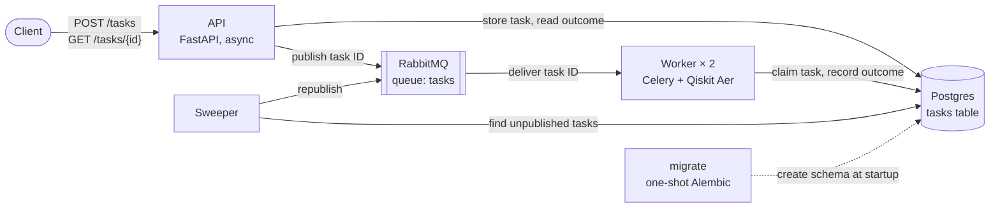
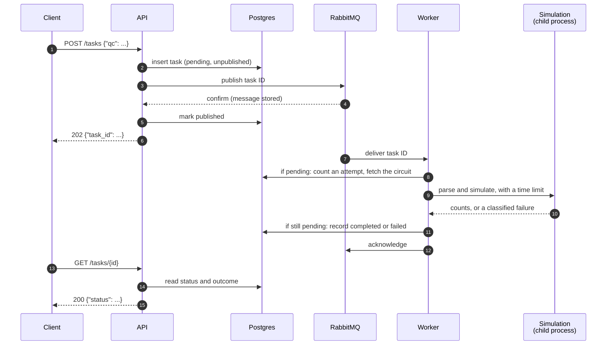

# classiq-hometask

A service that accepts quantum circuits over HTTP, simulates them asynchronously, and returns the measurement counts.

- [Setup](#setup)
- [Usage](#usage)
- [Architecture](#architecture)
- [Configuration](#configuration)
- [Testing](#testing)
- [Design decisions](#design-decisions)
- [Future work](#future-work)

## Setup

**Prerequisites**

- Docker with Docker Compose v2.
- About 5 GB of memory for Docker: each of the two worker containers is limited to 2 GB (decision 12).
- For the tests only: [`uv`](https://docs.astral.sh/uv/) 0.13 or later, which installs Python 3.12 itself.

**Run the system**

```sh
docker compose up --build --detach --wait
```

This builds the images, starts Postgres and RabbitMQ, runs the database migrations, then starts the API, two workers and the sweeper. `--wait` returns once every health check passes. The API listens on <http://localhost:8000>.

Other useful commands:

```sh
docker compose logs --follow api worker sweeper   # follow the logs
docker compose up --detach --scale worker=4       # run more workers
docker compose down                               # stop and remove the containers; keeps the data volumes
docker compose down --volumes                     # stop and delete all data
```

## Usage

Interactive API docs, generated from the code, are served at <http://localhost:8000/docs>.

**Submit a circuit.** The body is `{"qc": "<OpenQASM 3 text>"}`:

```sh
curl -s -X POST http://localhost:8000/tasks \
  -H 'Content-Type: application/json' \
  -d '{"qc": "OPENQASM 3.0; include \"stdgates.inc\"; qubit[2] q; bit[2] c; h q[0]; cx q[0], q[1]; c = measure q;"}'
```

```json
{"task_id": "3f6c1a2e-8f0b-4d7e-9a51-2c4b7e0d9f13", "message": "Task submitted successfully."}
```

**Poll for the result** with the returned `task_id`:

```sh
curl -s http://localhost:8000/tasks/3f6c1a2e-8f0b-4d7e-9a51-2c4b7e0d9f13
```

```json
{"status": "completed", "result": {"00": 518, "11": 506}}
```

Counts always sum to the worker's shot count (1024 by default). Poll until `status` is no longer `pending`; a task normally finishes within seconds.

### Responses

`POST /tasks`

| HTTP | Body | When |
|---|---|---|
| 202 | `{"task_id": "<uuid>", "message": "Task submitted successfully."}` | The task is accepted: stored and published |
| 400 | `{"status": "error", "message": "body.qc: Field required"}` | The body isn't JSON, or `qc` is missing, not a string or empty; the message names the problem |
| 413 | `{"status": "error", "message": "Circuit is larger than the limit of 65536 bytes."}` | The circuit exceeds `MAX_CIRCUIT_BYTES` |
| 503 | `{"status": "error", "message": "The service is busy. Submit the task again later."}` | The queue is full or RabbitMQ is unavailable; the `Retry-After` header says when to retry, and the task was not accepted |

`GET /tasks/{task_id}`

| HTTP | Body | When |
|---|---|---|
| 200 | `{"status": "pending", "message": "Task is still in progress."}` | Not finished yet |
| 200 | `{"status": "completed", "result": {"00": 518, "11": 506}}` | Simulated; `result` maps each measured bitstring to its count |
| 200 | `{"status": "error", "message": "<reason>"}` | The task failed; see below |
| 404 | `{"status": "error", "message": "Task not found."}` | No task has this ID (including IDs that aren't UUIDs) |

A failed task's `message` explains why. Examples:

| Cause | Example message |
|---|---|
| Not valid QASM3 | `Invalid QASM3: ...` with the parser's message |
| Too large for the worker's memory budget | Aer's message: `Insufficient memory ... Required memory: 2048M, max memory: 1700M` |
| No measurements, or another simulator error | The error's type and message, e.g. `QiskitError: No counts for experiment ...` |
| Ran past the time limit | `Simulation exceeded the time limit of 60 seconds.` |
| Killed by the operating system | `Simulation was killed by the operating system (signal 9). The usual cause is exceeding the worker's memory limit.` |
| Its worker crashed on every attempt | `The worker running the task was lost 3 times, so it was not run again.` |

`GET /health`

| HTTP | Body | When |
|---|---|---|
| 200 | `{"status": "ok"}` | Postgres and RabbitMQ are reachable |
| 503 | `{"status": "error", "message": "Postgres is unreachable."}` (or `RabbitMQ`) | A dependency is down |

Any unexpected server error returns 500 with `{"status": "error", "message": "Internal server error."}`.

## Architecture



| Service | Role |
|---|---|
| `api` | Validates requests, stores tasks, publishes them, and serves their outcomes. Only does I/O. |
| `worker` | Consumes the queue with Celery, one simulation at a time per container, and records each outcome. Does all CPU-heavy work: parsing and simulating. |
| `sweeper` | Publishes tasks the API stored but never published (it crashed in between), and warns about tasks pending too long. |
| `postgres` | The source of truth for every task: its circuit, state, outcome and attempt count. |
| `rabbitmq` | Delivers task IDs to workers and bounds the backlog. |
| `migrate` | Applies the database migrations, then exits; the other services start only after it succeeds. |

### The path of a task



What happens when something goes wrong along this path:

- **RabbitMQ rejects or doesn't confirm the publish (steps 3–4):** the API deletes the row and answers 503 (decision 11).
- **The API crashes between storing and marking published (steps 2–5):** the sweeper publishes the task after a grace period (decision 14).
- **The worker dies mid-task:** the message was never acknowledged, so RabbitMQ redelivers it. Each delivery counts an attempt; past `MAX_ATTEMPTS` the task fails with `WORKER_LOST` (decision 5).
- **The task is delivered twice:** both writes are conditional on the task being `pending`, so the first outcome recorded wins (decision 10).
- **Postgres is down when recording the outcome:** the worker retries in place, then returns the message to the queue (decision 18).

### Repository layout

A `uv` workspace with one package per service (decision 8):

| Path | Contents |
|---|---|
| `packages/common` | The contracts shared by every service: the `tasks` table, status and error-code enums, the task message and queue, the publisher, logging setup, and the Alembic migrations |
| `packages/api` | The FastAPI service |
| `packages/worker` | The Celery worker: task handler, supervised simulation runner, and the task store with its retries while the database is unreachable |
| `packages/sweeper` | The sweeper loop and its health check |
| `tests/integration` | Black-box tests against the full Compose stack |
| `tests/support/fakes` | In-memory test doubles for each service's task store, and a simulated database outage |

## Configuration

Every setting is an environment variable with a default. To change one passed through by `compose.yaml` (all but `DATABASE_URL`, `RABBITMQ_URL` and `SWEEPER_HEARTBEAT_FILE`), set it in the shell or in a `.env` file next to `compose.yaml`, which Docker Compose reads automatically, then run `docker compose up --detach` again:

```sh
TASK_TIMEOUT_SECONDS=120 WORKER_STOP_GRACE_PERIOD=135s docker compose up --detach --wait
```

| Variable | Default | Service | Purpose |
|---|---|---|---|
| `API_PORT` | `8000` | Compose | Host port the API is published on |
| `LOG_FORMAT` | `json` | all | `json` for structured logs, `console` for human-readable ones |
| `DATABASE_URL` | set by Compose | all | Postgres connection URL (SQLAlchemy, `psycopg` driver) |
| `RABBITMQ_URL` | set by Compose | all | RabbitMQ connection URL |
| `MAX_QUEUED_TASKS` | `10000` | api, worker, sweeper | Cap on messages waiting in the task queue; publishes beyond it are rejected and the API answers 503 |
| `PUBLISH_TIMEOUT_SECONDS` | `5` | api, sweeper | How long to wait for RabbitMQ to confirm a publish before treating it as failed |
| `MAX_CIRCUIT_BYTES` | `65536` | api | Largest accepted circuit, in UTF-8 bytes; larger ones get 413 |
| `RETRY_AFTER_SECONDS` | `5` | api | Value of the `Retry-After` header on a 503 |
| `SHOTS` | `1024` | worker | Shots per simulation |
| `TASK_TIMEOUT_SECONDS` | `60` | worker | Time limit per simulation; past it the task fails with `TIMEOUT` |
| `AER_MAX_MEMORY_MB` | `1700` | worker | Memory budget given to Aer; larger circuits fail with `CIRCUIT_TOO_LARGE` |
| `MAX_ATTEMPTS` | `3` | worker | Deliveries of a task before it fails with `WORKER_LOST` |
| `WORKER_CONCURRENCY` | `1` | worker | Simulations at once per worker container (decision 12 explains why 1) |
| `DB_TIMEOUT_SECONDS` | `10` | worker | Timeout of every database call, so none can hang |
| `DB_RETRY_FIRST_DELAY_SECONDS` | `1` | worker | First wait when retrying a call while Postgres is unreachable; doubles each time |
| `DB_RETRY_MAX_DELAY_SECONDS` | `30` | worker | Longest wait between those retries |
| `DB_OUTAGE_GIVE_UP_SECONDS` | `240` | worker | How long to keep retrying before returning the message to the queue |
| `WORKER_STOP_GRACE_PERIOD` | `75s` | Compose | How long Docker lets a stopping worker finish its task before killing it |
| `CONSUMER_TIMEOUT_MS` | `300000` | Compose (RabbitMQ) | How long a worker may hold a message unacknowledged before RabbitMQ requeues it |
| `SWEEP_INTERVAL_SECONDS` | `10` | sweeper | Time between sweeper passes |
| `SWEEP_GRACE_SECONDS` | `30` | sweeper | Age after which an unpublished task is published by the sweeper |
| `STALE_TASK_SECONDS` | `600` | sweeper | Age after which a pending task is logged as `stale_task` |
| `SWEEPER_HEALTHY_WITHIN_SECONDS` | `60` | sweeper | The health check fails if the last successful pass is older than this |
| `SWEEPER_HEARTBEAT_FILE` | `/tmp/sweeper-heartbeat` | sweeper (not set by Compose) | File touched after each successful pass, read by the health check |

Worker replicas, CPU and memory limits are set in `compose.yaml` (`deploy`), not by variables. Use `--scale worker=N` to change the replica count.

Some settings depend on each other:

- `SWEEP_GRACE_SECONDS` must exceed `PUBLISH_TIMEOUT_SECONDS`, so the sweeper never republishes a task whose request is still publishing it.
- `WORKER_STOP_GRACE_PERIOD` must exceed `TASK_TIMEOUT_SECONDS` plus about 15 s, so a stopping worker can finish its task.
- `CONSUMER_TIMEOUT_MS` should exceed `TASK_TIMEOUT_SECONDS` plus `DB_OUTAGE_GIVE_UP_SECONDS`, so a worker returns a message itself before RabbitMQ takes it back.
- `AER_MAX_MEMORY_MB` should stay about 300 MB below the worker's memory limit.
- `MAX_QUEUED_TASKS` is fixed when the queue is first declared, and RabbitMQ refuses to redeclare a queue with different arguments. To change it, delete the queue first, for example with `docker compose down --volumes`.

## Testing

Install the dependencies once:

```sh
uv sync --locked --all-packages
```

| What | Command | Needs |
|---|---|---|
| Type check | `uv run mypy` | — |
| Unit tests | `uv run pytest -m "not integration"` | Docker running: the worker and sweeper tests start a throwaway Postgres container with testcontainers |
| Integration tests | `uv run pytest -m integration` | Docker; takes several minutes |
| One file | `uv run pytest tests/integration/test_core_flow.py` | Whatever its tests need |

The integration tests build the images and start the whole stack as a separate Compose project, `classiq-hometask-test`, with the API on port 18000 and Postgres on 15432 (override with `TEST_API_PORT` and `TEST_POSTGRES_PORT`). They don't touch a stack started with `docker compose up`, and they remove their own stack and its volumes when they finish. Tests that stop or restart services are marked `resilience` and run last. Two integration runs at the same time on one machine collide, because they share the project name and ports.

CI runs the type check and unit tests in one job and the integration tests in another, on every push and pull request (`.github/workflows/ci.yml`). Decision 13 describes what each layer covers.

## Design decisions

### 1. Delivery guarantee: at-least-once

**Decision.** Every accepted task eventually reaches a final state (`completed` or `failed`), regardless of which component crashes along the way. A task is accepted only once it has been written to durable storage; the `task_id` is returned after that write succeeds, never before. If the write fails, the client receives a 5xx and no ID.

**Rationale.**

- The assignment's core requirement is that no submitted task is lost. At-most-once delivery (never retry) violates it outright.
- Exactly-once delivery is costly to build in a distributed system and exists to protect against non-repeatable side effects (e.g. charging a card twice). Simulating a circuit has no external side effects, so it buys nothing here.
- At-least-once means a circuit may occasionally be simulated twice, e.g. if a worker dies after simulating but before saving the result. The client still sees one task and one result; the only cost is CPU time. Counts may differ between the two runs because measurement is random, but either result is equally valid.
- Saving before responding closes the gap in which a client could hold an ID for a task the system never recorded.

### 2. Task lifecycle and failure reporting

**Decision.** A task has three states: `pending` → `completed` or `failed`. The API keeps the response shapes from the specification; a failed task is reported with the existing `error` status, and the HTTP status code distinguishes it from a missing task:

| Case | HTTP | Body |
|---|---|---|
| Pending | 200 | `{"status": "pending", "message": "Task is still in progress."}` |
| Completed | 200 | `{"status": "completed", "result": {...}}` |
| Failed | 200 | `{"status": "error", "message": "<reason>"}` |
| Not found | 404 | `{"status": "error", "message": "Task not found."}` |

**Rationale.**

- Some circuits can never succeed: too many qubits for available memory, no measurements, or never terminating. Without a final failure state, such a task would stay `pending` forever, which is indistinguishable from a lost task.
- The specification doesn't restrict `error` to "not found", so reusing it avoids extending the API contract. The message carries the reason.
- A failed task exists, so it returns 200; a missing one returns 404. Clients can branch on the status code without parsing message text.
- No separate `queued`/`running` states: clients only need to know whether the result is ready, and nothing in the design yet requires tracking whether a worker has picked the task up. They can be added if that changes.

### 3. Circuit validation happens in the worker

**Decision.** The API performs only cheap, structural checks: the body must contain a non-empty `qc` string no larger than `MAX_CIRCUIT_BYTES` (64 KB by default). Anything else is accepted. The worker parses the circuit and fails the task with the code `INVALID_CIRCUIT` and the parser's message when the circuit is not valid QASM3 (syntax errors, undefined gates).

Everything else is left to the simulator, and its own message is returned: a circuit with no measurements fails with Aer's "No counts for experiment", and circuits too large for the worker's memory are rejected by the simulator itself (decision 12).

**Rationale.**

- **Parsing is expensive.** Qiskit's stable QASM3 importer is pure Python. Measured parse times:

  | Circuit | Text size | Parse time |
  |---|---|---|
  | 2 qubits, 7 operations | 0.1 KB | 2 ms |
  | 25 qubits, 765 operations | 8.6 KB | 123 ms |
  | 25 qubits, 7,425 operations | 81 KB | 1.3 s |
  | 25 qubits, 29,625 operations | 320 KB | 5.8 s |

  Parsing on the API's event loop would stall every in-flight request, including status polls, for the duration. Offloading it to a process pool would work, but every circuit would then be parsed twice, once in the API and again in the worker, and the API would need CPU capacity of its own.
- **The worker must parse anyway**, and it is the component built for CPU-heavy work. Parsing once, there, keeps the API purely I/O-bound.
- **The trade-off** is feedback latency: a client who submits an invalid circuit learns of it by polling (`error` with a specific message) rather than from an immediate 400.
- **The size limit** bounds the worst-case parse cost and protects the API and broker from oversized payloads. Oversized requests are rejected with HTTP 413.
- Qiskit's experimental Rust importer (`qasm3.loads_experimental`) parses about 50× faster but does not yet support classical control flow such as `while`, so it was not used.

### 4. Task transport: RabbitMQ and Celery, with Postgres as the task store

**Decision.** Tasks are recorded in Postgres, which is the source of truth for each task's state and result. They are delivered to workers through RabbitMQ: workers consume with Celery, and the API publishes with `aio-pika`, an async RabbitMQ client, writing messages in Celery's task message format. On `POST /tasks` the API:

1. inserts the task row (`pending`, not yet published);
2. publishes it to RabbitMQ and waits for the broker's confirmation;
3. marks the row as published and responds with the `task_id`.

A sweeper service republishes any task still unpublished after a grace period, which covers a crash between steps 1 and 3 (decision 14).

**Rationale.**

- **Why a dedicated broker over Postgres-as-a-queue.** Postgres can serve as a queue (Rails' Solid Queue, Oban and River do this), and at this workload's scale throughput would not be the bottleneck: each task costs milliseconds to seconds of simulator CPU. But a broker provides admission backpressure natively (queue length limits, publisher blocking under memory or disk pressure), keeps queue churn off the database, and is the conventional production architecture that can scale independently of the store.
- **The dual-write gap.** Writing to Postgres and publishing to RabbitMQ are two separate operations; a crash between them would leave a task recorded but never delivered, violating decision 1. The `published` flag plus sweeper closes the gap. A crash after publishing but before setting the flag leads to a second publish, which at-least-once delivery tolerates.
- **Why publish in the request rather than a separate outbox relay.** Most tasks reach the queue immediately, with no relay polling delay and one fewer service; the sweeper only handles the crash case.
- **Why `aio-pika` rather than Celery's client in the API.** Celery's publishing API is synchronous; calling it from the async API would need a thread per publish. Celery's task message format (protocol v2) is small, documented and stable since Celery 4, so the API builds it directly in one function, covered by an integration test against a real worker. `aio-pika` enables publisher confirms by default, so a publish returns only once RabbitMQ has stored the message. The API has no Celery dependency.

### 5. Failure handling and retries

**Decision.** Failures are classified by cause, and only transient causes are retried:

| Cause | Example | Handling | Error code |
|---|---|---|---|
| Circuit fails validation | Invalid QASM3 | `failed`, no retry | `INVALID_CIRCUIT` |
| Circuit needs more memory than the worker's budget | 27-qubit statevector on a 1.7 GB budget | `failed`, no retry; the simulator's own message is returned | `CIRCUIT_TOO_LARGE` |
| Circuit raises during simulation, or the simulation process exits unexpectedly | Aer error, no measurements so no counts | `failed`, no retry; the simulator's own message is returned | `SIMULATION_ERROR` |
| Circuit exceeds time limit | Non-terminating loop | `failed`, no retry | `TIMEOUT` |
| Simulation killed by the OS | Memory use exceeds the container limit despite the simulator's own check | `failed`, no retry | `KILLED` |
| Database unreachable | Postgres down while saving | Retried in place, then the message is returned to the queue (decision 18) | (none; the outcome cannot be recorded) |
| Whole worker lost | Container or host crash | Redelivered by RabbitMQ; capped at `MAX_ATTEMPTS` (default 3) | `WORKER_LOST` |

Each Celery task runs the simulation in a supervised child process with a hard timeout. The supervising task survives every circuit-caused failure (exception, timeout, kill), so it can always classify the failure and record it. On failure the task row stores an error code and a human-readable message. The API returns only the message, preserving the specified response shape; the code is stored for querying and logged. Stack traces go to logs only.

Worker loss is covered by Celery's `acks_late` and `task_reject_on_worker_lost`: the message is acknowledged only after the task finishes, so if the worker dies RabbitMQ redelivers it. Each delivery increments an `attempts` counter on the task row; past `MAX_ATTEMPTS` the task is marked `failed` instead of run.

**Rationale.**

- **Circuit-caused failures are deterministic.** The same circuit fails the same way every time, so retrying only wastes worker time and delays the outcome.
- **Supervised child process.** A non-terminating simulation is stuck in Aer's C++ code, where Python cannot interrupt it, and an out-of-memory kill cannot be caught at all. Isolating the simulation in a child process means the supervising task can kill it on timeout and observe how it ended.
- **Attempt counter in Postgres rather than a RabbitMQ delivery limit.** RabbitMQ quorum queues can cap redeliveries and dead-letter the message, but something must then consume the dead-letter queue and mark the task `failed`, otherwise it stays `pending` forever. That consumer must also avoid re-running the dead-lettered Celery message. A counter on the task row is one `UPDATE` in code that already exists, and it keeps all task state, including the failure reason, in one place.

### 6. Shots

**Decision.** Every circuit runs with a fixed number of shots, 1024 by default, set by the worker's `SHOTS` environment variable. The API takes no shots parameter.

**Rationale.**

- The specification's input is only `{"qc": ...}`; adding a field would extend the contract without a stated need.
- 1024 matches the assignment's example and gives roughly ±3% precision on each outcome's probability, which is ample for demonstrating the system.
- The shot count isn't stored per task. Clients can't set it, and the counts in a result always sum to the shots used, so the result is self-describing.

### 7. Stack and deployment split

**Decision.** Python 3.12, with dependencies managed by `uv` and locked in `uv.lock`. The API and the worker are separate deployments with separate concurrency models:

- **API:** FastAPI with `async` endpoints, an async Postgres driver, and `aio-pika` for publishing. It does only I/O.
- **Worker:** Celery (synchronous), a synchronous Postgres driver, and Qiskit/Aer. It does all CPU-heavy work: parsing, validation and simulation.

**Rationale.**

- **FastAPI** validates request bodies against typed models and serves interactive API docs at `/docs`.
- **Async API.** Status polling (`GET /tasks/<id>`) will be the highest-volume endpoint and is pure database I/O, which is where an event loop outperforms a thread pool. Moving parsing to the worker (decision 3) left the API with no CPU-bound work to block the loop.
- **Sync worker.** Celery tasks are synchronous, and the worker's cost is dominated by simulation CPU, so async I/O would gain nothing there.
- **Python 3.12** is fully supported by every dependency. Newer versions risk missing prebuilt wheels for Qiskit Aer, which would mean compiling C++ during the Docker build.
- **`uv`** gives fast, reproducible installs from a lock file, keeping Docker builds deterministic.

### 8. Repository layout and shared contracts

**Decision.** A single repository organised as a `uv` workspace with four packages:

- `common`: the contracts the services depend on, namely the `tasks` table definition, status and error-code enums, and the task message (Celery task name and argument shape), plus the async publisher shared by the API and the sweeper.
- `api`: the FastAPI service.
- `worker`: the Celery worker.
- `sweeper`: the service that republishes unpublished tasks (decision 14).

Each service has its own dependencies and Dockerfile. The schema is managed with Alembic migrations, run by a one-shot `migrate` service in Docker Compose; the API, worker and sweeper start only after it completes successfully.

**Rationale.**

- The services share contracts but almost no dependencies: the API needs no Qiskit or Celery, and the worker needs no FastAPI. Separate packages keep each image lean, and the API image avoids hundreds of MB of simulator libraries.
- Keeping the contracts in one package means a change is a single edit that both services pick up, rather than duplicated definitions that can drift silently.
- A dedicated migration step means neither service owns the schema, and `docker compose up` on a fresh machine always starts from the correct schema.

### 9. Task message contents and circuit storage

**Decision.** The task message carries only the task ID. Circuits are stored in Postgres alongside the task, not in a separate store. When a worker starts a task, a single statement both increments the attempt counter and returns the circuit.

**Rationale.**

- **ID only.** Postgres remains the single source of truth and the message is just a pointer, so the two can never disagree. Messages stay around 100 bytes, which suits RabbitMQ. Fetching the circuit costs nothing extra because the worker already updates the row to count the attempt (decision 5).
- **No separate blob store.** Circuits are capped at 64 KB and typically 0.1–10 KB. Postgres compresses values over about 2 KB and stores them outside the main row (TOAST), so status polls, which never select the circuit, don't pay for it. Storing payloads in an object store and passing a reference (the claim-check pattern) pays off for multi-megabyte payloads. Here it would add a second dual-write problem (blob, then row), another service, and another round trip per task. The pressure on Postgres at scale comes from row count and write rate, which an object store would not relieve.

### 10. Duplicate execution: conditional writes, first writer wins

**Decision.** Every write by a worker applies only while the task is still `pending`:

- **On start:** `UPDATE tasks SET attempts = attempts + 1 WHERE id = :id AND status = 'pending' RETURNING circuit, attempts`. If no row is returned, the task is already final, and the worker acknowledges the message without simulating.
- **On finish:** `UPDATE tasks SET status = :final, ... WHERE id = :id AND status = 'pending'`. The first writer wins; a later writer updates no rows, logs that it discarded a duplicate result, and acknowledges.

Once a task reaches a final state, it never changes.

**Rationale.**

- At-least-once delivery (decision 1) allows two scenarios: a task that finished but whose acknowledgement was lost is redelivered, and a worker whose broker connection drops keeps simulating while RabbitMQ redelivers the task to another worker, so two runs overlap.
- Without conditional writes, a redelivered task would overwrite a finished result, and overlapping runs would make a result change after a client had read it, or let a failure overwrite a success.
- The condition is checked in the same statement as the write, inside the store that holds the data, so it is correct under any interleaving of workers.
- **Distributed locking was considered and deferred.** A per-task lock (for example in Redis) would prevent most duplicate runs and save their CPU time. It cannot guarantee correctness on its own: a lock must expire so that a crashed holder doesn't block the task forever, and it can then expire while its holder is still alive (a network partition or a long pause), letting a second worker start. Writes would still need to be guarded in Postgres. Since the conditional write already guarantees correctness and a duplicate run only costs one simulation, the lock was left out to keep the system simple at the current scale.

### 11. Backpressure: bounded queue, load shedding at the API

**Decision.** The task queue is capped at `MAX_QUEUED_TASKS` messages with RabbitMQ's `reject-publish` overflow behaviour. If a publish is rejected because the queue is full, fails because the connection is down, or receives no confirmation within `PUBLISH_TIMEOUT_SECONDS`, the API deletes the task row it just inserted and responds with HTTP 503 and a `Retry-After` header.

**Rationale.**

- **Without a cap,** the queue grows without bound, waiting time grows with it, and eventually RabbitMQ's memory or disk alarms block all publishers, leaving requests hanging until clients time out.
- **`reject-publish` rather than the default `drop-head`.** RabbitMQ's default overflow behaviour silently discards the oldest queued message, which would lose an accepted task. `reject-publish` refuses the new message instead, and with publisher confirms the API learns this immediately.
- **The timeout covers silence, not errors.** Some broker states produce no answer at all: under a resource alarm RabbitMQ deliberately stops reading from publishing connections, a half-open TCP connection is only detected by heartbeats after about a minute, and a reconnecting client waits for the outage to end. The timeout bounds how long a client can be left without an answer.
- **503 with `Retry-After` rather than 429.** 429 signals that a particular client is sending too much; here the system as a whole is at capacity.
- **Deleting the row keeps the response truthful.** A client that received 503 should not later find its task executed. If the publish actually succeeded despite the timeout, the worker finds no pending row and skips the message (decision 10). If the API crashes before deleting, the sweeper eventually publishes the task; it runs and is never read, which is harmless.
- **No queue-depth check before inserting.** It would cost a round trip per request and is racy under concurrency; the broker's own cap is authoritative.

### 12. Worker resources: one simulation per container

**Decision.** Each worker container runs one simulation at a time (Celery `--concurrency=1`). Throughput scales by adding replicas. Defaults:

| Setting | Default | Purpose |
|---|---|---|
| Worker replicas | 2 | Parallel simulation slots |
| CPU limit per container | 2 | All available to the single running simulation |
| Memory limit per container | 2 GB | Container budget |
| Aer `max_memory_mb` (`AER_MAX_MEMORY_MB`) | 1700 | Simulator budget: container limit minus ~300 MB for Python, Qiskit and Celery. Allows up to 26 qubits with the statevector method |
| `TASK_TIMEOUT_SECONDS` | 60 | Hard limit per simulation |

All values are configurable through environment variables and the Compose file.

**Rationale.**

- **Each simulation gets the whole budget.** With several simulations per container, memory and cores must be divided between them, which caps the largest circuit the system can run as concurrency grows.
- **No coupled settings.** Several simulations per container would require the memory budget and the simulator's thread count to be divided consistently by the concurrency level; a mismatch would cause CPU oversubscription or out-of-memory kills. One simulation per container has a single budget, and the simulator uses all of it.
- **Failure isolation.** An unexpected out-of-memory kill or hang affects one container and one task.
- **One scaling setting.** Throughput is the replica count, the same unit container orchestrators scale by. The cost is about 300 MB of duplicated base memory per slot.
- **The simulator enforces the memory limit.** Given `max_memory_mb`, Aer calculates each circuit's memory needs for the simulation method it will actually use and refuses circuits that don't fit, with a precise message. This replaces a static qubit limit, which would be less accurate. The worker must check the result's `success` flag, because Aer reports this failure in the result rather than raising.
- **60 s timeout.** A 27-qubit, 1024-shot simulation measured 3.6 s, so legitimate circuits within the memory budget finish far below the limit, while non-terminating circuits are stopped within a minute.

### 13. Testing strategy

**Decision.** Three layers, all run in CI (GitHub Actions) on every push:

- **Unit tests** for logic that is intricate in isolation: the Celery message encoder, the publisher's failure handling, failure classification, the database retry policy, and the sweeper's loop and health check. The API's routes, the worker's task handler and the sweeper's pass run against in-memory fakes of their task stores: request validation and load shedding, skipping a final or missing task, the attempt cap, stopping before simulating when the database is unreachable, and skipping a rejected publish. The simulation runner's tests simulate real circuits with Aer, covering counts, invalid QASM3, no measurements, too large for the memory budget, a timeout and an unexpected simulator error.
- **Task-store tests against a real Postgres**, in a throwaway container started by testcontainers: each service's statements, behind the interface the rest of its code uses. The worker's store keeps the first of two recorded outcomes, counts attempts, and retries and then gives up while the database is unreachable. The sweeper's store skips tasks another batch holds and finds stale tasks. The API's store reads each stored outcome back in its response shape.
- **Integration tests**, black-box over HTTP against the full Compose stack, which a pytest fixture starts with `docker compose up --wait` (blocking until every health check passes). A test override file shortens the worker's time limit to 15 s, so the slow cases run quickly, and publishes Postgres's port, so tests can inspect and arrange task rows. The queue-full test lowers the queue cap with a temporary RabbitMQ policy.

| Group | Tests |
|---|---|
| Core flow | Submit a Bell circuit and receive `completed` with counts summing to 1024 over keys `00` and `11`; `pending` is observed first; an unknown ID returns 404; a malformed body returns 400; an oversized body returns 413; `/health` returns 200 |
| Failures | Invalid QASM3 reports the parser's message; a non-terminating loop reports a timeout |
| Backpressure and sweeper | The queue is declared with its cap and `reject-publish`; a full queue returns 503 with `Retry-After`, and the accepted tasks complete once workers resume; a task stored but never published still completes |
| Resilience | Workers are killed mid-task and the task runs again after they restart; RabbitMQ restarts while tasks are queued (workers stopped), then workers start and every task completes, and a task submitted after the restart is accepted (the API reconnected on its own); tasks queued when the RabbitMQ container is replaced complete, because its fixed hostname keeps the data volume's messages; workers stopped mid-task finish it before exiting, without a redelivery; the API and sweeper exit cleanly on SIGTERM; RabbitMQ's consumer timeout is 5 minutes |

**Rationale.**

- **The resilience tests are the evidence for the core requirement.** "No task is lost" is a claim until a test kills a worker and the task still completes.
- **Synchronise on state, never on time.** Fault-injection tests are prone to flakiness when they guess timing with fixed sleeps. Instead, the worker-kill test polls Postgres until the task's attempt counter shows a worker has started it, then kills all worker replicas (avoiding a guess about which one holds the task) and restarts them. The broker-restart and queue-full tests stop the workers first, so nothing runs concurrently and there is no race. All waits poll for the expected state with a generous deadline, so slow machines make tests slower, not flaky.
- **The broker-restart test asserts completion rather than sampling queue depth.** Published tasks have no recovery path other than their RabbitMQ message (the sweeper only republishes unpublished tasks), so if the restart lost them they would stay `pending` and the test would fail. Completion proves the messages survived and remained consumable. The test documents this assumption, since a future mechanism that republishes stale tasks would mask message loss.
- **Isolation.** Resilience tests are marked and run after the core tests, and each restores the stack in a `finally` block, so one failure cannot cascade.
- **Tests run from the host.** Killing and restarting containers needs the Docker CLI, which a containerised test runner could only reach by mounting the Docker socket.
- **Duplicate handling is tested at the task store** because arranging an overlapping redelivery end to end would depend on timing; recording two outcomes through the store directly is deterministic.

### 14. The sweeper is a dedicated service

**Decision.** A separate `sweeper` service, one replica by default, closes the dual-write gap from decision 4. Every `SWEEP_INTERVAL_SECONDS` (10 s) it selects tasks that are still unpublished and older than `SWEEP_GRACE_SECONDS` (30 s) using `FOR UPDATE SKIP LOCKED`, publishes them with the same publisher the API uses, and marks them published. If a publish is rejected (for example, the queue is full), the task stays unpublished and is retried on the next pass. The service reports the time of its last successful pass through its health check. It also logs a warning for tasks stuck in `pending` (decision 18).

**Rationale.**

- **Not a background loop in the API.** A loop embedded in a web server can die silently from an unhandled exception while the API keeps serving and stays healthy. It multiplies with every server process and API replica, and it ties the sweeper's scaling and lifecycle to the API's.
- **Not Celery Beat.** Beat must run as exactly one instance, and it would publish through Celery's client, creating a second publishing path alongside the API's.
- **Safe failure mode.** If the sweeper is down, unpublished tasks wait in Postgres until it restarts; nothing is lost, only delayed. Its health check makes a stuck sweeper visible.
- **`SKIP LOCKED`** lets several sweepers run without publishing the same task twice, so replicas can be added for redundancy without coordination.
- **The grace period exceeds the API's publish timeout** (decision 11), so the sweeper never picks up a task whose submission request is still publishing it.

### 15. Task IDs and result storage

**Decision.** Task IDs are random UUIDs (version 4), generated by the API before inserting. The result (counts) is stored as `JSONB` on the task row, alongside the error code and message and the timestamps `created_at`, `started_at` and `finished_at`.

**Rationale.**

- **The API has no authentication, so an ID is the only thing protecting a task's result.** Sequential IDs would let anyone read every result by counting, and would reveal task volume. UUIDv4 has 122 random bits, so IDs cannot be guessed.
- **UUIDv4 over UUIDv7.** Time-ordered UUIDv7 improves index locality under very heavy insert load, but it reveals creation time and needs an extra library on Python 3.12. Neither trade is worth it at this scale.
- **Generated by the API**, so the ID is known before the insert and no round trip is needed to obtain it.
- **Result on the task row.** A result is at most 1024 entries (one per distinct outcome over 1024 shots) and has the same lifetime as its task, so a status poll is a single-row read. A separate results table would pay off for large results (such as full statevectors), several results per task (such as per-attempt history), or different retention for results and task records. None applies today, and splitting later is a straightforward migration.
- **Timestamps** support the sweeper's grace period (`created_at`) and make queue wait and run time measurable.

### 16. Operations: logging, health checks, graceful shutdown

**Decision.**

- **Logging:** structured JSON logs to stdout via `structlog`, with the `task_id` on every task-related line in the API, worker and sweeper. `LOG_FORMAT` switches to human-readable output for local development.
- **Health checks** for every service, wired into Compose's `depends_on: condition: service_healthy`:

  | Service | Check |
  |---|---|
  | API | `GET /health` returns 200 when Postgres and RabbitMQ are reachable, otherwise 503 |
  | Worker | `celery inspect ping` |
  | Sweeper | Last successful pass is recent |
  | Postgres | `pg_isready` |
  | RabbitMQ | `rabbitmq-diagnostics ping` |

- **Graceful shutdown:** on SIGTERM the API finishes in-flight requests and closes its connections, the sweeper completes its current pass, and the worker finishes its current task (Celery warm shutdown). The worker's `stop_grace_period` is 75 s.

**Rationale.**

- **Structured logs** can be filtered and aggregated by field in any log system, and a shared `task_id` lets one filter follow a task through every service.
- **Health checks** order startup so services don't start before their dependencies are ready, let `docker compose up --wait` (used by the integration tests) know when the stack is usable, and make a stuck component visible.
- **The worker's grace period exceeds the 60 s task timeout.** Docker's default of 10 s would kill in-flight simulations on every redeploy. They would be redelivered and re-run, which is correct under at-least-once delivery but wasteful.

### 17. HTTP conventions

**Decision.** `POST /tasks` returns **202 Accepted**. Every error response, including malformed requests, uses the specification's shape `{"status": "error", "message": "<reason>"}`:

| Case | HTTP |
|---|---|
| Malformed body (not JSON, missing, non-string or empty `qc`) | 400 |
| Unknown task ID, or one that isn't a UUID | 404 |
| Circuit larger than `MAX_CIRCUIT_BYTES` | 413 |
| Unexpected server error | 500 |
| Queue full or broker unavailable | 503, with `Retry-After` |

**Rationale.**

- **202** is the standard code for a request accepted for processing that has not completed, which is exactly what task submission is.
- **One error shape.** FastAPI's default validation response (422 with a `detail` array) differs from every other error this API returns. Converting it lets clients handle all errors the same way.

### 18. Tasks stuck in `pending`

**Decision.** A task can only be stuck if its message is gone or held indefinitely while its row is still `pending`. Worker death is already covered by redelivery (decision 5); three further paths are handled:

1. **Database unreachable when recording an outcome.** The worker retries the write in place with exponential backoff (capped at 30 s between tries), holding its one message and taking no new tasks. If the database is still unreachable after `DB_OUTAGE_GIVE_UP_SECONDS` (240 s), it returns the message to the queue unacknowledged (Celery's `Reject(requeue=True)`) for a later attempt. Every failed write is logged as an error with the task ID. The returned message has already used an attempt, so a task whose outcome can't be recorded through `MAX_ATTEMPTS` consecutive outages fails with `WORKER_LOST`.
2. **A worker alive but stuck** (for example, blocked on a call that never returns). RabbitMQ's `consumer_timeout` is set to 5 minutes, so a delivery held longer than that is returned to the queue. The worker's database calls have their own timeouts.
3. **A message lost despite durable, persistent, confirmed publishing** (disk failure, a purged queue, misconfiguration). The sweeper logs a `stale_task` warning for any task `pending` longer than `STALE_TASK_SECONDS` (600 s). It does not republish them.

**Rationale.**

- **The failure can't be recorded when the database is down.** Marking the task `failed` would itself require the database. Acknowledging the message without recording an outcome would leave the task `pending` forever, so the message is returned rather than dropped. Celery's default retry behaviour has exactly this flaw: once `max_retries` runs out, the failed task's message is acknowledged.
- **Retry in place rather than Celery's `retry()`.** `retry()` with unlimited retries would also be correct, but it schedules delayed messages that the worker holds in memory while continuing to fetch more. During an outage each worker would pull the whole queue into memory, and every task would retry the database simultaneously when it recovered. Retrying in place limits each worker to one held task and one connection attempt at a time, leaving the rest of the queue in RabbitMQ.
- **Give up before `consumer_timeout`.** Returning the message after 240 s keeps the worker under RabbitMQ's 5-minute limit, so the hand-back is deliberate rather than a forced channel closure. The re-run simulation is harmless (decision 10).
- **The consumer timeout exceeds the 60 s task timeout** with ample margin, so it fires only for genuinely stuck workers. RabbitMQ's default of 30 minutes would leave such a task waiting too long.
- **Stale tasks are detected, not republished.** Under heavy load a task legitimately waiting in a long queue looks the same as one whose message was lost. Republishing would create duplicate runs whose attempts could falsely fail a healthy task with `WORKER_LOST`. It would also mask message loss, the failure the warning exists to expose, and invalidate the broker-restart test's assumption (decision 13).

## Future work

- **Retention policy:** delete or archive tasks older than a configurable age, bounding table growth. Partition the table by creation date if volumes grow further.
- **Per-task locking:** add a distributed lock to reduce duplicate simulations if they become a measurable cost, keeping the conditional writes as the correctness guarantee (decision 10).
- **Claim-check storage:** move circuits to an object store if the size limit is ever raised into the megabytes.
- **Centralised logs in Elasticsearch:** ship every service's JSON logs to Elasticsearch (for example with Filebeat or Fluent Bit reading the container output) and search them in Kibana. The logs are already structured with a `task_id` on every task-related line (decision 16), so one query would follow a task through the API, the worker and the sweeper, and the `stale_task` and `database_unavailable` events could drive alerts. Today the logs are read with `docker compose logs`, which keeps them only as long as the containers exist.
